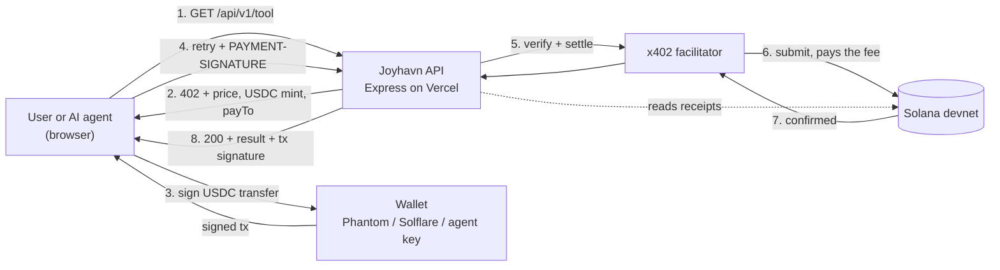

<div align="center">


# Joyhavn

### Pay for tools only when you need them.

**A pay-per-request API marketplace on Solana, powered by x402. Humans and AI agents pay a fraction of a cent in USDC over plain HTTP. The payment *is* the access control. No accounts. No API keys. No subscriptions.**


**[Live demo](#-links)** · **[Demo video](#-links)** · **[How Solana powers Joyhavn](#-how-solana-powers-joyhavn)** · **[Run it locally](#-setup--run-locally)**

</div>

---

## 🔗 Links

| | |
|---|---|
| 🌐 **Live demo** (Solana devnet) | **[ADD YOUR LIVE URL, e.g. https://joyhavn.vercel.app]** |
| 🎬 **Demo video** (2–4 min) | **[ADD YOUR VIDEO LINK]** |
| 🧾 **Proof of a real payment** | **[ADD ONE SOLANA EXPLORER TRANSACTION LINK (devnet)]** |
| 🏆 **Track** | Best Use of x402 on Solana, Encode Club |

> **Judges, the fastest way to try it:** open the live demo → **Services** → pick **JSON Validator ($0.003)** → **Connect wallet** → **Pay** → approve in your wallet → see the result and a public Solana receipt. Full steps in [Try it in 2 minutes](#-try-it-in-2-minutes).

---

## 💡 The problem

Most useful online tools are worth **fractions of a cent per use**: checking a link, validating a file, fetching a price.

Today that forces a bad choice:

- **Cards can't do it.** A $0.005 payment loses money to card fees before it starts.
- **Subscriptions and API keys are heavy.** You create an account, add a card and manage a key just to use something once.
- **AI agents can't do it at all.** An autonomous agent can't fill in a sign-up form or enter card details, so the tools it needs are locked behind human onboarding.

## ✨ The solution

Joyhavn turns every tool into a plain HTTPS endpoint with a **price per request**. The server answers with the standard HTTP status **`402 Payment Required`** (revived by [x402](https://x402.org)). The caller signs a small USDC transfer, **it settles on Solana**, and the result comes back in the same request.

```text
You (or your AI agent)  →  ask for a tool
Joyhavn                 →  402 Payment Required: "0.005 USDC to this address"
You (or your agent)     →  sign a USDC transfer, retry
Solana                  →  the payment settles on-chain
Joyhavn                 →  200 OK + the result + a public transaction receipt
```

No account was created. No key was issued. No card was charged. Every purchase has a receipt anyone can verify on Solana Explorer.

---

## 🧠 How Solana powers Joyhavn

> Solana is not a login button here. **It is the gate, the cash register and the receipt.** Remove Solana and the product stops working.

| # | Role of Solana | How it shows up in Joyhavn |
|---|---|---|
| 1 | **Solana is the access control.** | A service unlocks *only* when a USDC transfer is verified and settled on Solana. There is no database of users, no session and no API key to steal. The settled payment is the proof of access. |
| 2 | **Sub-cent economics.** | Prices like **$0.003 to $0.01** are viable because Solana's base fee is a fraction of a cent (5,000 lamports). The same payment on a card network would cost more in fees than it earns. |
| 3 | **Fee abstraction.** | The x402 facilitator is the transaction's fee payer, so a buyer needs **only USDC**. No SOL, no gas, no extra step, which keeps onboarding simple. |
| 4 | **Fast, final settlement.** | The server returns the result in the same HTTP request once the payment settles. The Home page shows live slot, throughput and slot time read from the Solana RPC. |
| 5 | **Public, verifiable receipts.** | Every response carries the transaction signature, linked to Solana Explorer. The **Developers** page reads merchant earnings **directly from the chain** (token-account history), not from our own database. |
| 6 | **Wallets for machines.** | Anyone, or any program, can create a Solana keypair instantly. That makes **AI agents with their own wallets and spending caps** possible with no signup. See [Agent mode](#-agent-mode-ai-agents-that-pay-for-their-own-tools). |
| 7 | **Non-custodial by design.** | Joyhavn never holds user funds or keys. The user's wallet signs each payment. The merchant wallet is paid directly. |

### Why not just use cards or subscriptions?

| | Card / Stripe | Subscription + API key | **Joyhavn (x402 on Solana)** |
|---|---|---|---|
| Works for a $0.005 purchase | ❌ fees exceed the price | ⚠️ you pay for a month to use it once | ✅ |
| Needs an account | ✅ | ✅ | ❌ |
| Usable by an AI agent with no human | ❌ | ❌ | ✅ |
| Public proof of purchase | ❌ | ❌ | ✅ on-chain |
| Merchant paid instantly | ❌ days | ❌ monthly | ✅ same request |

---

## 🚀 Try it in 2 minutes

### Option A: with your own wallet (the real flow)

1. Install **Phantom** (or Solflare) and switch it to test money:
   *Phantom → Settings → Developer Settings → **Testnet Mode** on.*
2. Get free **devnet USDC** for your wallet at [faucet.circle.com](https://faucet.circle.com): choose **Solana → Devnet → USDC**, paste your address, send.
3. Open the live demo → **Connect wallet**.
   - **On a phone:** tap your wallet, approve in its app, and you return to Safari already connected.
   - **On desktop:** pick your wallet extension and approve.
4. Go to **Services**, choose **JSON Validator ($0.003)**, tap **Pay** and approve in your wallet.
5. You get the result and a **transaction link**. Open it on Solana Explorer (cluster: **Devnet**).

### Option B: watch an AI agent pay for its own tools

1. Open **Agent** → **Create agent wallet** (generated in your browser, test money only).
2. Copy the agent's address, send it devnet USDC from [faucet.circle.com](https://faucet.circle.com), then press **Refresh balance**.
3. Press **Run agent** with the example task. It chooses the tools, pays for each one itself, and returns an answer with a receipt per purchase.

### See the paywall with `curl` (no wallet needed)

```bash
curl -i "https://<your-domain>/api/v1/json-validator?json=%7B%22a%22%3A1%7D"
```

You receive **`HTTP 402 Payment Required`** with a `payment-required` header describing the price, the USDC mint, the merchant address and the Solana network. That is x402 working.

---

## 🧩 Features

- **Real x402 v2 payments on Solana** using the `exact` scheme, paid in USDC.
- **Bring your own wallet.** Phantom, Solflare and Backpack through the Wallet Standard on desktop, plus an encrypted **Safari → wallet app → back to Safari** flow on phones. No pasting keys or addresses.
- **Agent mode.** Describe a task. An agent plans which tools to buy, pays with its own capped wallet and writes the answer.
- **Four working paid services** (below), each validated *before* the paywall so you are never charged for a request that would fail.
- **Verify any receipt on-chain.** Paste a transaction signature and Joyhavn checks it directly on Solana: confirmed, a USDC transfer, paid to the merchant, fee sponsored by the facilitator. Every receipt in the app has a **Verify** link.
- **Agent-ready by design.** A machine-readable catalog at `/api/catalog` and plain-language instructions at `/llms.txt` let *any* external AI agent discover the tools and pay for them with x402.
- **On-chain Developers dashboard.** Merchant earnings read directly from Solana.
- **Live Solana network panel.** Slot, throughput and slot time from the RPC.
- **Honest failure handling.** Rejected, forged, underfunded or expired payments deliver nothing and charge nothing, with a plain-language message.
- **Activity and analytics** kept privately in the user's own browser.
- **Zero build step.** Plain ES modules on the front end, one Express app on the back end, deployable to Vercel.

### Paid services

| Service | Endpoint | Price | What it does |
|---|---|---|---|
| 🔗 **URL Safety Scan** | `GET /api/v1/url-safety-scan?url=` | $0.005 | Heuristic phishing and wallet-drainer scoring for a link: a risk level, score and reasons. A signal, not a guarantee. |
| 📝 **AI Summary** | `GET /api/v1/ai-summary?text=` | $0.008 | Concise summary of text. Uses Claude when configured, otherwise a built-in summariser, so it never fails after payment. |
| 📊 **Data Snapshot** | `GET /api/v1/data-snapshot?asset=` | $0.01 | Live crypto price, 24h and 7d change, volume and rank (CoinGecko public API). |
| 🧪 **JSON Validator** | `GET /api/v1/json-validator?json=` | $0.003 | Validates and formats JSON; reports the exact line and column of an error. |

---

## 🤖 Agent mode: AI agents that pay for their own tools

Machine-to-machine micro-purchases are exactly what cards and accounts cannot do and **Solana plus x402 can**.

1. **You give a task**, e.g. *"Is `https://phantom-airdrop-claim.secure-verify.xyz/connect-wallet` safe, and what is SOL doing today?"*
2. **The agent plans.** It picks the services it needs (here: URL Safety Scan and Data Snapshot). Planning uses Claude when `ANTHROPIC_API_KEY` is set, otherwise keyword rules. Every planned input is validated before use.
3. **The agent pays for each tool itself** from its own throwaway Solana wallet through the normal x402 flow, with no human approval per purchase.
4. **A spending cap protects you.** The cap per task (default $0.05) is enforced *before* any purchase, and no single request may exceed 0.05 USDC.
5. **You get the answer plus a public Solana receipt for every purchase.**

The agent's wallet is a Solana keypair generated in the browser (WebCrypto Ed25519), funded with devnet test USDC. The key never leaves the device.

---

## 🏗️ Architecture



### Payment sequence

```mermaid
sequenceDiagram
    participant C as Client (user / agent)
    participant A as Joyhavn API
    participant F as x402 Facilitator
    participant S as Solana

    C->>A: GET /api/v1/json-validator?json=...
    A->>A: validate input (free, no charge)
    A-->>C: 402 Payment Required (amount, USDC mint, payTo, fee payer)
    C->>C: build USDC TransferChecked, wallet signs
    C->>A: GET again + PAYMENT-SIGNATURE
    A->>F: verify payment
    F-->>A: valid
    A->>A: run the service
    A->>F: settle
    F->>S: submit transaction (facilitator pays the fee)
    S-->>F: confirmed
    F-->>A: settled + signature
    A-->>C: 200 OK + result + PAYMENT-RESPONSE (tx signature)
```



### What the transaction contains

Built in `public/solana.js` with **no dependencies** and covered by unit tests. It matches what the x402 `exact` scheme verifies:

1. `ComputeBudget: setComputeUnitLimit`
2. `ComputeBudget: setComputeUnitPrice`
3. `SPL Token: TransferChecked` (buyer's USDC → merchant's USDC account)
4. `Memo` with a random nonce (makes every payment unique)

Signer slot 0 is the facilitator (fee payer, signs on settlement). Slot 1 is the buyer's wallet.

### On phones: Safari → wallet app → back

On mobile, wallet extensions don't exist in Safari, so Joyhavn uses the wallets' **universal-link protocol**. The page sends a connect or sign request to the wallet app, the user approves, and the wallet returns them to Safari with the answer. Requests and replies are **end-to-end encrypted** with a one-off key pair (NaCl box, bundled `tweetnacl`), so nothing sensitive travels in a URL. A payment waiting for approval is saved and finished automatically when the user returns. See `public/deeplink.js`.

---

## 🛡️ Failed payments and fairness

**Nothing is delivered and nothing is charged unless the payment settles on Solana.**

| Situation | What happens | Charged? |
|---|---|---|
| Invalid input (bad URL, broken request) | Rejected *before* the paywall with a clear error | No |
| Payment cancelled in the wallet | "You cancelled in your wallet" | No |
| Forged or invalid signature | Verification fails, `402` returned | No |
| Not enough devnet USDC | Clear message with a faucet link | No |
| Approval took too long (blockhash expired) | Asks the user to try again | No |
| Merchant payout account not activated | Plain-language notice, nothing sent | No |
| Settlement fails after the service ran | No result delivered | No |
| Upstream provider down (e.g. market data) | Looked up *before* the paywall, so the user isn't asked to pay | No |

The UI includes a **Simulate failed payment** button that sends a forged payment so you can see rejection handling live.

---

## 🔒 Security and safety design

- **Non-custodial.** No user funds or keys are ever held by the server. The wallet signs every payment.
- **Spend limits.** No single request may exceed **0.05 USDC**, and the agent enforces a per-task cap before buying.
- **Validate first, charge later.** Inputs are checked before the 402 is issued.
- **Rate limiting** on the demo and agent routes; request bodies are size-limited.
- **Devnet only.** Test money throughout. The optional server-side demo wallet is disposable and devnet-only.
- **Agent key stays local.** The agent wallet's key is generated and stored in the browser and never sent to the server.
- **Privacy.** Activity history and analytics live in the user's own browser storage. Nothing about the user is stored on the server.
- **Honest limits.** The URL scan is a heuristic signal and the Data Snapshot depends on a public market API; both are documented below.

---

## 📁 Project structure

```text
joyhavn/
├── api/index.js               Vercel serverless entry (wraps the Express app)
├── dev.js                     Local server (npm run dev)
├── src/
│   ├── app.js                 Express app: x402 paywall, free API routes, agent routes
│   ├── services.js            The four paid services + input validation
│   ├── agent.js               Agent planner and report writer (Claude or rules)
│   ├── receipt.js             Turns a Solana transaction into a verifiable payment receipt
│   ├── solanaRpc.js           Balances, blockhash, token accounts, network stats, on-chain receipts
│   ├── market.js              Live market data (CoinGecko)
│   ├── summarize.js           AI summary (Claude or local fallback)
│   ├── demoBuyer.js           Optional server-side demo buyer (x402 client)
│   ├── x402util.js            Reads x402 headers for display (signing and settlement use the official @x402 libraries)
│   └── errors.js
├── public/                    Front end: no build step, hash routing
│   ├── index.html, styles.css, app.js
│   ├── wallet.js              Wallet Standard connection (desktop / in-app browsers)
│   ├── deeplink.js            Phone flow: Safari → wallet app → back (encrypted)
│   ├── nacl.js                Bundled tweetnacl (public domain)
│   ├── solana.js              Dependency-free transaction builder and base58
│   ├── x402-browser.js        Pay-with-wallet x402 client
│   ├── agent-wallet.js        The agent's own browser wallet
│   └── llms.txt               Instructions for external AI agents
├── scripts/
│   ├── keygen.js              Generate a devnet wallet
│   └── buyer.js               Command-line x402 buyer
├── test/                      Automated tests
├── vercel.json
└── .env.example
```

---

## 🧰 Tech stack

| Layer | Technology |
|---|---|
| Payments | **x402 v2** (`@x402/core`, `@x402/express`, `@x402/fetch`, `@x402/svm`), `exact` scheme |
| Chain | **Solana devnet**, USDC (SPL token), `@solana/kit` |
| Server | Node.js ≥ 20, Express, deployed as a Vercel serverless function |
| Front end | Vanilla ES modules, no framework, no build step |
| Wallets | Wallet Standard (Phantom, Solflare, Backpack) and universal links for phones |
| Crypto | WebCrypto Ed25519 (agent wallet), NaCl box (phone flow) |
| AI (optional) | Claude for the agent's planning and for AI Summary, with automatic local fallbacks |

---

## ⚙️ Setup & run locally

### Prerequisites

- **Node.js 20 or newer**
- A Solana wallet such as [Phantom](https://phantom.app) (for testing)

### 1. Install

```bash
git clone <YOUR-REPO-URL>
cd joyhavn
npm install
```

### 2. Create the merchant wallet

The merchant wallet *receives* payments. You only need its public address.

```bash
npm run keygen
```

Or use any Solana devnet wallet you control. Copy its **public address**.

### 3. Fund it with test USDC (once)

The merchant needs a USDC token account before it can receive payments, and any devnet USDC deposit creates it.

- Open [faucet.circle.com](https://faucet.circle.com) → **Solana → Devnet → USDC** → paste the merchant address.
- Buyers need devnet USDC too (same faucet). They do **not** need SOL, because the facilitator pays the fee.

### 4. Configure

```bash
cp .env.example .env
```

| Variable | Required | Purpose |
|---|---|---|
| `SOLANA_PAY_TO` | **Yes** | Public address of the wallet that receives payments |
| `FACILITATOR_URL` | No | x402 facilitator. Default `https://x402.org/facilitator` supports Solana devnet |
| `DEMO_BUYER_PRIVATE_KEY` | No | Powers the optional **Quick demo (no wallet)** button. Disposable, devnet only |
| `ANTHROPIC_API_KEY` | No | Use Claude for AI Summary and agent planning. Falls back to local logic if unset |
| `SOLANA_RPC_URL` | No | A dedicated devnet RPC (the public one is rate limited) |
| `PORT` | No | Local port (default `4021`) |

### 5. Run

```bash
npm run dev
# open http://localhost:4021
```

Check `http://localhost:4021/api/health`. You should see `"configured":true`.

### Deploy to Vercel

1. Push the repository to GitHub (keep the folder structure: `api/`, `public/`, `src/` at the top level).
2. Import it in Vercel. No build command is needed.
3. Add the environment variables above (at least `SOLANA_PAY_TO`).
4. **Redeploy** (variables apply to new deployments only).
5. Open `/api/health` and confirm `"configured":true` and `"merchantAccount":true`.

---

## ✅ Testing

```bash
npm test
```

Automated tests cover:

- the dependency-free **Solana transaction builder** (exact instruction layout, account order, empty signature slots, base58);
- the **agent planner** and report writer;
- the **services** and input validation;
- the **encrypted wallet-reply** round trip used by the phone flow;
- the **receipt verifier** (valid payments, wrong recipient, failed and unknown transactions);
- the **API without configuration** (free routes work, paid routes refuse and never charge).

You can also pay from the command line with the included x402 buyer, e.g. `npm run buyer -- url-safety-scan "https://example.com"` (needs `DEMO_BUYER_PRIVATE_KEY`).

---

## 🧭 Limitations (honest ones)

- **Devnet only.** All money is test USDC. Moving to mainnet means switching the network and USDC mint and using a production facilitator.
- **URL Safety Scan is heuristic.** It scores lexical and structural risk signals; it is not a reputation database and not a guarantee.
- **Data Snapshot depends on CoinGecko's public API**, which can rate-limit. Failures are detected *before* the paywall so users aren't charged.
- **The agent's planner is intentionally simple** (rules, or Claude if configured) and the services are deliberately small. The focus is the **payment-to-access flow**, which is reusable for any API.
- **Phone wallet flow** relies on the wallets' universal links. If an in-app browser blocks the redirect, open the site in Safari or inside the wallet's browser.

## 🗺️ Roadmap

- **Publish your own API**: a self-serve registry where any developer lists an endpoint and a price and gets paid on-chain.
- **Agent spending policies**: per-tool allow-lists, daily budgets and approval thresholds.
- **Mainnet** with production facilitator and USDC.
- **Service reputation**: on-chain receipts as a verifiable usage history.
- **Streaming and metered pricing** for long-running tools.

---

## 🎯 How Joyhavn maps to the judging criteria

| Criterion | Where to see it |
|---|---|
| Meaningful integration of **both x402 and Solana** | Every service is behind an x402 `402` paywall; every payment is a real USDC transfer settled on Solana. See [How Solana powers Joyhavn](#-how-solana-powers-joyhavn). |
| **Reliability of the payment-to-access flow** | Validate → 402 → sign → verify → settle → deliver, with clean failure paths. Try **Simulate failed payment**, then prove a real payment on the **Verify a receipt** page (checked directly against Solana). |
| **A compelling use case** beyond a basic demo | **Agent mode**: AI agents buying tools with their own capped wallets, which cards and accounts cannot support. Plus a public `/api/catalog` and `/llms.txt` so *external* agents can discover and pay too. |
| **Clear documentation and sensible failure handling** | This README, the [failure table](#-failed-payments-and-fairness), and friendly in-app error messages. |
| Working demo on devnet | [Live demo](#-links) and [Try it in 2 minutes](#-try-it-in-2-minutes). |
| Repository with README and setup | [Setup & run locally](#-setup--run-locally). |
| 2–4 minute demo video | [Links](#-links). |
| Clear explanation of how Solana powers the project | [How Solana powers Joyhavn](#-how-solana-powers-joyhavn). |

---

## 🙏 Acknowledgements

Built for the **Encode Club** Solana hackathon. Thanks to the [x402](https://x402.org) team and the open-source Solana ecosystem, to [tweetnacl-js](https://github.com/dchest/tweetnacl-js) (public domain) for the phone-flow encryption, and to CoinGecko for the public market-data API.

## 📄 License

MIT

<div align="center">

**Joyhavn: pay for tools only when you need them.**

</div>
